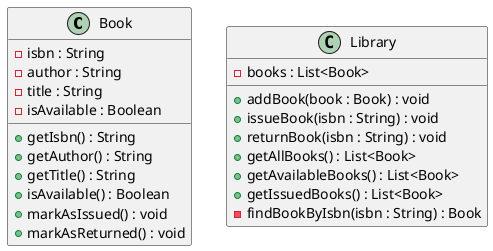

# Проектирование классов

## UML-диаграмма

Ниже представлен код PlantUML для диаграммы классов.

## Ответы на вопросы

**Вопрос 1. Какие атрибуты Book должны быть неизменяемыми после создания? Почему?**
Неизменяемыми должны быть атрибуты `isbn`, `author` и `title`. ISBN — это уникальный идентификатор, если его менять, можно потерять книгу в системе. Автор и название также являются постоянными характеристиками конкретного издания, их изменение может нарушить целостность данных.

**Вопрос 2. Где должно храниться состояние «книга выдана / доступна» — в классе Book или в классе Library? Обоснуйте.**
Состояние должно храниться в классе `Book` (например, в виде поля `isAvailable`). Сама книга «знает», свободна она или нет, это её внутреннее свойство. Класс `Library` лишь управляет этим состоянием, вызывая методы книги (выдать/вернуть), но не хранит статус отдельно от неё.

**Вопрос 3. Какие методы Library должны быть публичными, а какие — внутренними (вспомогательными)? Приведите пример метода, который не должен быть публичным, и объясните, что может пойти не так, если его сделать публичным.**
Публичными должны быть методы, с которыми работает пользователь или система (добавить книгу, выдать, вернуть, получить списки). Внутренним (приватным) должен быть метод `findBookByIsbn`, так как он нужен только для поиска книги внутри самой библиотеки. Если сделать его публичным, внешний код сможет напрямую получать объекты книг и менять их состояние в обход правил библиотеки (например, просто вызвав `markAsIssued()` у найденной книги, не проверяя, не выдана ли она уже).
